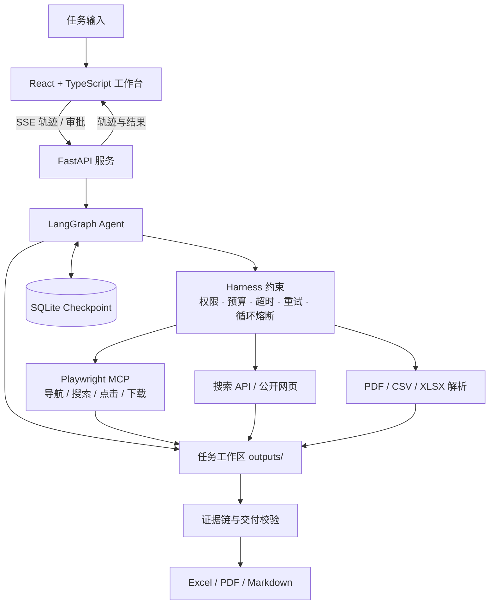
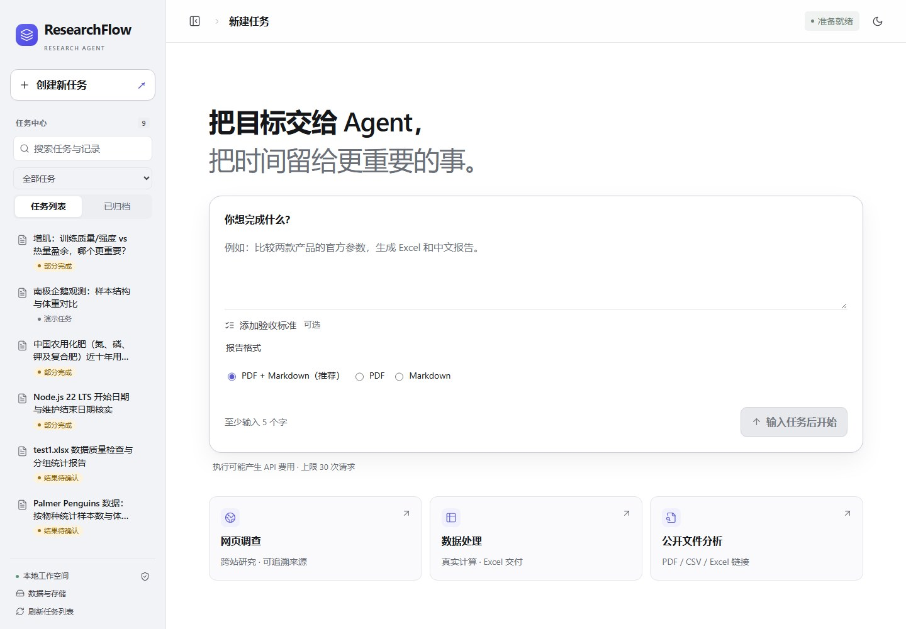
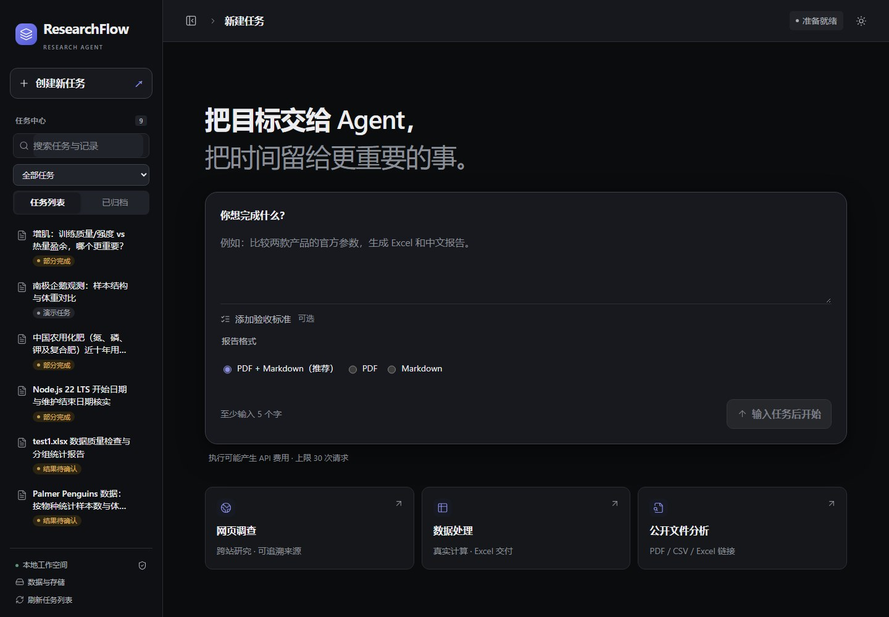
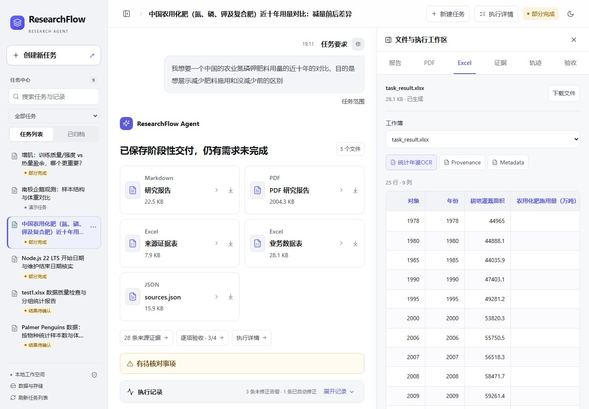

# ResearchFlow · 独立 Web 工作台

[](https://github.com/adrianwen98/ResearchFlow/actions/workflows/tests.yml)
[](https://www.python.org/)
[](https://react.dev/)
[](https://github.com/adrianwen98/ResearchFlow/releases)

**当前基线（2026-10-26）：后端 709 项、前端 95 项测试通过，TypeScript 检查和生产构建通过。** 支持任务优先交互、浅色/深色模式、数据备份与恢复、重启后未开始任务的可恢复提示；历史阶段文档保留原始快照。

基于 **React + TypeScript + Vite + FastAPI** 的 Agent 任务工作台，复用现有 LangGraph + Playwright MCP 核心。首页直接输入任务；历史任务可收起，完整工具轨迹按需展开，结果与交付文件优先呈现。Gradio 保留为备用。

## 架构



模型只负责根据观察选择下一步；工具权限、执行预算、超时、重试和循环熔断由宿主 Harness 约束，交付前再做证据链与数据结构校验。

Windows：首次运行 `setup_web_windows.bat`，之后双击 **`run_web_windows.bat`**，访问 http://127.0.0.1:8000/ 。已有 `.venv` 可以直接复用。模型密钥仅在服务端 `.env`。查看历史案例免费；点击“开始执行”会创建真实任务并可能计费，提交前展示预算；恢复和审批继续保留确认。

- [任务优先 UX 改动、截图与验收](docs/UX_OPTIMIZATION.md)
- [独立 Web 安装、接口与限制](docs/WEB_WORKBENCH.md)
- [2–3 分钟演示流程](docs/WEB_DEMO_3_MINUTES.md)
- [前后端架构](docs/ARCHITECTURE.md)
- [简历与面试边界](docs/RESUME.md)
- [隐私与数据流](PRIVACY.md) · [更新记录](CHANGELOG.md) · [许可证](LICENSE)





当前测试与交付边界以本页顶部和 [独立工作台说明](docs/WEB_WORKBENCH.md) 为准；以下是保留的原始安装与历史说明，其中旧 Gradio 截图和旧测试数据属于当时快照。

---

# ResearchFlow

基于LangGraph、DeepSeek Tool Calling和Playwright MCP的单Agent网页研究与数据处理工作台。模型根据工具观察选择下一步；宿主约束权限、预算、重试和恢复。无额外RAG、多Agent或低代码平台。



## 运行

Windows 10/11、Python 3.12、Node.js 22.12+、已安装 Edge。双击`setup_windows.bat`安装锁定依赖并运行免费测试；Python未安装时清楚报错，也可设置`PYTHON312_EXE`指向自己的3.12。准备好`.env`再双击`run_windows.bat`。查看随包演示无需密钥或模型请求；创建新任务需要自己的DeepSeek Key并可能计费。启动脚本不自动执行模型任务。

```powershell
.\.venv\Scripts\python.exe -m pytest -q --basetemp work\tests
.\.venv\Scripts\python.exe -m scripts.restore_demo_tasks
.\run_windows.bat api
```

API默认127.0.0.1:8000，Gradio默认127.0.0.1:7860。定位是本地单用户演示，不能直接作为公开多租户服务部署。

## 能力与证据

- 显式LangGraph decide→execute→verify；真实MCP搜索、点击、下拉和下载；PDF、CSV/XLSX、pandas和动态业务表格。
- 宿主工具权限、调用预算、超时、分类重试、循环检测、journal和SQLite Checkpoint；危险操作需审批或转人工。
- 按需Skills、明确偏好/已验收摘要Memory、历史上下文裁剪、逐项需求、版本绑定最终验收。
- 本轮126项离线回归通过，详细结果见[验证摘要](validation_summary.json)。离线测试不等于真实模型任务数；本轮没有新增付费调用。
- 历史真实案例：20次DeepSeek请求，真实浏览器下载12074字节XLSX，下载后终止并重启Python进程，从同一Checkpoint继续。4次工具错误；摘录登记接受过一次反馈，报告未手改。搜索结果以观察ref跟随打开。
- 公开数据案例：344条企鹅观测，缺失值质检、物种样本数和体重均值。[数据来源与许可](THIRD_PARTY_DATA.md)。这是脚本工具复现（0 API），不是新增模型自主性验收。

公开演示为只读的脱敏副本，只有精选事件、来源节选及交付文件，没有原始私有日志、Memory或Checkpoint。新任务的完整状态只保存在自己的本地目录。不要把脱敏历史演示当成刚刚执行的任务。

[架构与状态契约](ARCHITECTURE.md) · [三分钟演示](DEMO_3_MINUTES.md) · [最终交付与限制](CAREER_DELIVERY.md)

## 完成与限制

needs_review表示结果待确认；当前文件和全部需求检查通过后，可由用户确认，或由用户明确指定的客观契约通过独立检查后completed。未完成需求不能通过勾选全部ID绕过。浏览器现场恢复不等于图恢复；任意写操作、登录/支付、任意Python及通用网站成功率均不承诺。

XLSX只读首表最多5000行，聚合前20组；浏览器下载大小在完成后检查。来源摘录与文件校验不等于语义事实自动保证。费用以自己的服务商账单为准。

## 公开发布

此目录不含Git历史及`.env`。个人密钥只放本机`.env`，日志/outputs/work/SQLite均由`.gitignore`排除。不要从私人开发目录直接git add所有文件。此交付仅准备目录和ZIP，没有替你上传GitHub或创建公开仓库。


安装实测：空虚拟环境的缓存安装、126项测试及Gradio启动已通过；当前代理下完全无缓存联网安装失败，详见交付记录，未绕过TLS/哈希校验。
