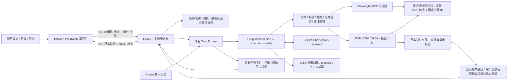
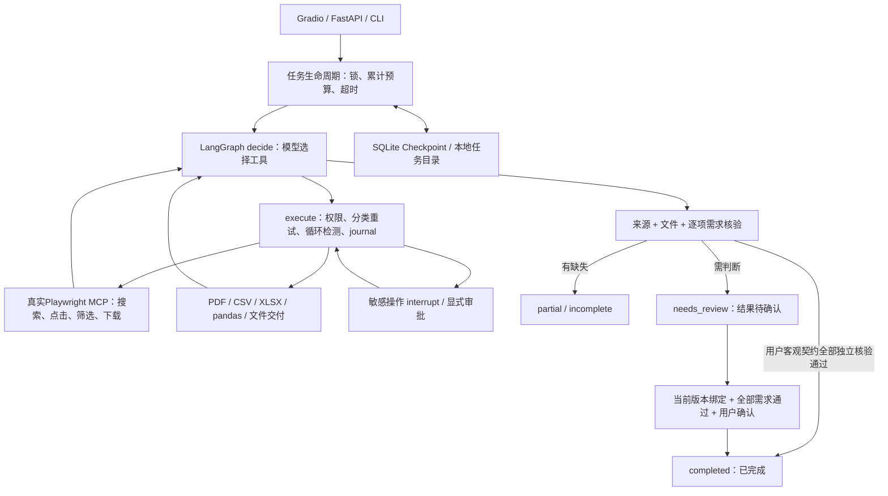

# 当前架构：独立 ResearchFlow 工作台

React 不参与模型决策，不维护第二套任务状态机；界面操作能力由后端实际 Checkpoint、进程锁、审批、预算和交付核验决定。新增接口和逐项边界见 [WEB_WORKBENCH.md](WEB_WORKBENCH.md)。下文为保留的 Agent 核心技术说明。

---

# 技术架构与状态契约

- 图控制结构固定，URL、工具及调整路径由模型根据观察选择；公开企鹅案例另有脚本复现标识。
- `completion._accept_delivery`同时检查版本、真实文件、全部需求检查和当前状态。缺失需求不能靠勾选全部ID绕过，也不写入长期记忆。
- `current_result`会使旧的无效完成状态失效。文件或需求改变后须重新核验。
- 公共状态统一在`web_agent/status.py`。queued等待队列、running执行、awaiting_review等待操作审批、needs_review结果待确认、completed已完成、partial部分、incomplete未完成、permission_denied权限停止、budget_exceeded预算耗尽、stalled循环停止、timeout超时、interrupted中断、error异常。
- 只有completed点亮最后一步；needs_review停在人工验收。操作审批与交付验收是两个不同阶段。
- Memory只保存用户明确偏好和已验收摘要；Skills按需加载；上下文按字符与完整消息组裁剪，不宣称语义事实保证。
- 原生浏览器重启仅重建最后URL，旧ref/Cookie/表单现场不承诺恢复；文件和图状态持久保存。模糊外部副作用不自动重发。
- 公开目录不含原始Checkpoint和Memory。脱敏历史演示只读，新任务仍可在本机生成自己的Checkpoint。

最终网络出口、自动完成的保守条件与最新185/21项测试见 [最终稳定性记录](FINAL_STABILITY.md)。
