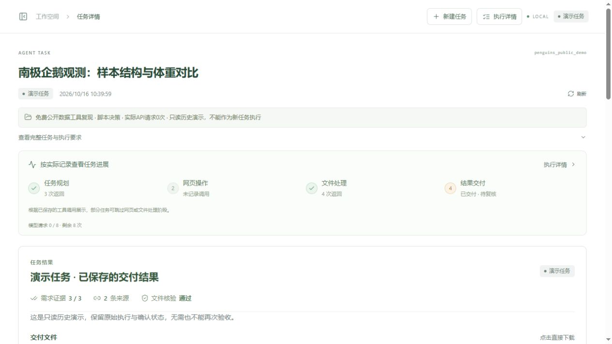
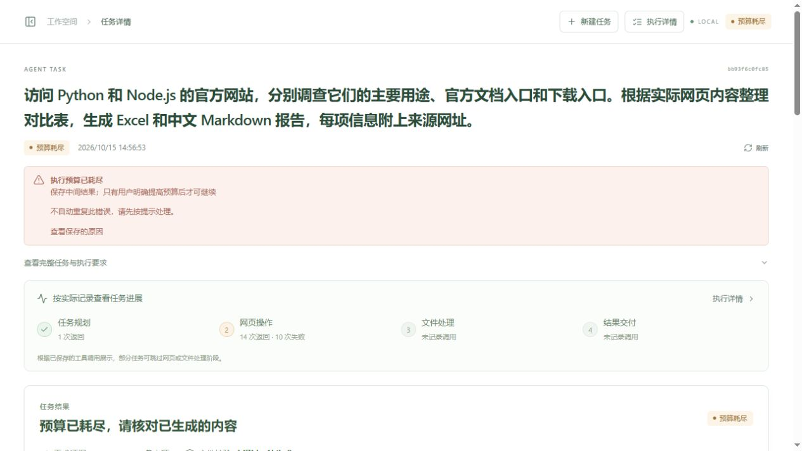

# 最后一轮功能与稳定性验收（2026-10-16）

本轮保留 LangGraph 单 Agent、现有 FastAPI/React 工作台及 Gradio 备用入口；没有增加框架或依赖。新增付费模型请求 **0 次**，历史请求额度、任务和 Checkpoint 未重置。

## 修复结论

| 真实问题 | 当前实现与证据 |
| --- | --- |
| 正常公开网站受固定白名单限制 | 默认 `NETWORK_MODE=public`；`strict` 才启用 `ALLOWED_DOMAINS`。真实 MCP 已读取原名单外 IANA 页面。 |
| DNS 预检查与浏览器实际连接之间存在再次解析 | 新增每个会话自动启动/关闭的本机临时出口，对全部 A/AAAA 地址检查后，只向已验证的数字 IP 建立 TCP；TLS 仍由浏览器/HTTP 客户端验证。 |
| Fake-IP 被特例视为公网 | 移除例外。非公网解析结果一律拒绝；本机采用固定公网 HTTPS DNS，普通环境默认系统 DNS。未更改系统代理或系统 DNS。 |
| 不同连续错误被统一当作循环 | 明确超时/连接、404、登录与验证码、参数、失效 ref、安全拒绝、摘录不匹配等类别，返回中文原因和 next_action。不同可纠正错误允许有限调整，真正重复无进展才熔断。 |
| 重试和恢复可使预算统计不完整 | 模型请求、工具尝试（含自动重试）和时间均持久化。审批节点恢复复用同一次预算预留；被取消读取不能在预算耗尽后免费重放。 |
| 完成状态易误读 | 保留原状态值；needs_review 展示“结果待确认”。区分 execution_finished、confirmation_state 与实际完成回执模式。missing/pending/failed 必要需求无法完成。 |
| 所有任务均强制人工验收 | 增加保守的客观自动检查：只有用户明确给出的 machine_check 能启用；模型不能自我认证。自由文本研究、主观解释、人工处理和指定人工验收保留确认。 |
| 用户不接受结果时没有明确入口 | “要求修改 / 拒绝交付”保存版本绑定的原因、标为部分完成，并在有容量时追加待满足的用户要求；不调用模型。显式继续仍用原 Checkpoint 与预算。 |
| 演示任务无法再次验收却显示待复核 | 显示“演示任务”，说明只读与历史状态，无需再次确认；原始结果状态没有伪改为成功。 |
| 失败原因藏在工具日志 | 主区域显示后端中文原因、应对方式、可否有限重试，未满足要求直接列出；原有详细轨迹保留折叠。 |
| 下载可重复或只检查后缀 | 文件来源、实际类型/解析、体积、路径和 SHA256 检查；同任务已下载文件通过 hash 后复用，不执行内容。 |

## 网络边界

`web_agent/egress.py` 是进程内按会话管理的临时代理，不是新增独立部署的微服务。浏览器匿名隔离上下文强制使用它，禁用代理本机绕过、QUIC、非代理 WebRTC；页面初始化时关闭 WebRTC/WebTransport，阻止 WebSocket，禁用 Service Worker。HTTP/PDF/CSV/XLSX 下载工具同样经过固定 IP 出口，不继承环境代理。

公开目标仅 HTTP/HTTPS、80/443；拒绝账号密码 URL、歧义数字地址、区域 IPv6、内网/环回/链路本地/元数据/多播、IPv4 映射和地址转换 IPv6。任一 DNS 结果不安全则拒绝，不从混合答案挑选一个公网地址蒙混通过。连接到的实际 peer IP 也要与固定地址一致。重定向和子资源的新连接都经过同一出口。strict 模式在出口也执行域名限制，因此可能需要显式加入 CDN 域名。

`PUBLIC_DNS_MODE=system` 为一般环境默认；本机 Fake-IP 环境使用 `cloudflare`，通过固定 `https://1.1.1.1/dns-query`、正常 TLS 校验取得 A/AAAA。DoH 不可用时明确失败，不回退放行 Fake-IP。域名将交给选定的公共 DNS 服务解析。普通网页读取无逐次审批；未知或敏感交互仍由宿主拒绝或转人工。普通 POST 只接受绑定 URL、请求体、期限的一次性审批能力。

网络实现参考 [Playwright 网络与代理](https://playwright.dev/docs/network)、[WebSocket 路由](https://playwright.dev/docs/api/class-websocketroute)、[Cloudflare DoH JSON](https://developers.cloudflare.com/1.1.1.1/encryption/dns-over-https/make-api-requests/dns-json/)。这些资料用于设计，不替代本项目测试证据。

## 自动完成的准确边界

`completion_decision()` 先检查真实文件、来源与全部必要需求。自动完成要求每项都是**用户输入的确定性契约**，支持来源 URL+指定原文、明确聚合参数及从原始文件复算、指定工作表列和最小行数、报告必须包含的明确文字。自由文本描述或模型自行拆分的需求没有这种客观契约，因此进入结果待确认；不能仅凭“导出了报告”或“引用过来源”自动认证研究结论。

REST 示例（仅说明可验证契约，不是新的业务模板）：

```json
{"task":"提取指定来源原文", "review_mode":"auto", "requirements":[{"description":"报告引用指定来源原文","kind":"research","machine_check":{"type":"source_quote","url":"https://example.com/","quote":"用户明确指定的实际原文"}}]}
```

上例只有来源真实观察、记录、最终报告及文件均验证通过才会完成；不存在的原文不能通过。`review_mode=manual` 或任务明确要求人工确认时不自动完成。普通 React 文本输入不自动制造 machine_check，因此多数开放式研究仍显示结果待确认，但现在有直接确认、解释和拒绝/修改入口。

自动完成回执使用 `automatic_objective_checks`；用户验收使用 `human_acceptance`。两者绑定交付版本，文件或需求变动会失效。自动任务摘要不会冒充用户认可写入长期 Memory。最多16项需求，达到上限时修改意见仍单独保存并强制人工确认，不静默删除旧需求。

## 本轮验证结果

- **185 项 Python 测试通过**，含原有全部关键回归；**21 项前端测试通过**；TypeScript、生产构建及 pip check 通过。
- 新增离线测试覆盖 DNS 混合答案、IPv4/IPv6/转换地址、固定连接 IP、真实代理 socket 的恶意重定向、严格模式出口、失效元素重定位、四种可纠正错误后的重新规划、权限不重试、累计请求/工具/时间预算、取消节点恢复、客观自动完成及失效、未满足需求拒绝验收、拒绝交付接口。
- **免费真实公开网络**：通过实际 MCP 读取 IANA 保留域名页面（原白名单外），同会话快照正常；本机/元数据/IPv6回环/file URL 被拒绝。真实下载 pandas XLSX **12074字节、7行**，实际解析包含负数；第二次下载复用已验证文件。
- **真实 MCP + 受控页面**：实际搜索输入、点击、下拉、原生 CSV 下载，负数、统计与业务 Excel 核验通过；这是受控测试，不是新增模型自主性案例。
- **真实 MCP + 受控恶意页面**：图片、fetch、WebSocket 和重定向未连接本机哨兵（连接数0）；WebRTC/WebTransport 在页面脚本前不可用。另有公网重定向探针被第三方自己返回403，**不计为本项目拦截成功**。
- 前端浏览器验证继续使用历史真实任务及隔离免费 UI 服务：确认按钮的前置检查、拒绝交付及状态更新正常。生产历史任务仍为20请求/35工具，未重跑或归零。

本机原始证据位于 `evidence/stability_pytest.xml`、`stability_frontend_tests.json`、`stability_public_mcp.json`、`stability_boundary_mcp_fixture.json`、`stability_interaction_mcp_fixture.json`、`stability_validation.json`。这些文件不会自动进入公开导出。公开摘要为 `docs/stability_validation_summary.json`。

## 关键修改文件

- `web_agent/security.py`、`egress.py`、`config.py`、`browser.py`、`scripts/browser_guard.cjs`：网络检查、固定出口和 MCP 接入。
- `harness.py`、`graph.py`、`runner.py`：错误、纠错建议、熔断、持久化预算、取消恢复。
- `completion.py`、`status.py`、`api.py`、`web_views.py`：客观/人工验收、修改意见、真实状态与中文反馈。
- `documents.py`、`tools.py`、`browser_actions.py`：下载类型、路径、hash、复用与真实解析。
- 现有 React 的 App、TaskOverview、TaskProgress、DeliveryPanel、Shared、types/model/ux：小范围状态与反馈增强；布局保留。
- `tests/test_stability_final.py` 等回归及免费验证脚本；没有新增前端或后端依赖。

## 剩余限制及展示标准

1. **没有新增 DeepSeek 在线端到端回归**。不能把脚本模型测试、受控页面或公开文件 smoke 宣称为新增自主任务成功率。
2. 网络控制是对正常浏览器/工具的应用级边界，不是 Windows 防火墙或 VM/容器隔离，不能防御已被利用的浏览器进程任意出网。未假称具备操作系统级网络沙箱；公网多租户部署不在范围内。
3. 原生浏览器下载在完成后核验大小，无法保证下载过程中不占用超额带宽/临时磁盘；HTTP 文件工具有流式大小限制。HTTP 文件工具不自动跟随重定向，需核对目标后再调用。扫描 PDF/OCR、验证码、登录、支付和通用远程写入仍不开放。
4. Checkpoint 恢复图、文件与预算；浏览器重启重建 URL，旧 ref、Cookie 和表单现场不保证恢复。未知是否已生效的外部提交禁止自动重发。
5. 时间预算现在累计持久化。异常进程终止后未结算的时间按保守墙钟计算，停机时间也可能消耗剩余时间；不会自动重置，需要用户明确调整配置。
6. 工作簿处理仍受首表/5000行、聚合前20组及有界预览约束；公开数据事实含义仍可能需要用户判断。

已具备作为**本地公开网页研究与数据处理 Agent 求职项目**展示的条件，不能承诺任意网站或任意开放式任务稳定完成。前端、原有 Agent Loop、审批、Checkpoint、Memory/Skills 和交付回归保持通过。本轮之后停止功能扩展，转入安全的 GitHub 导出、简历和面试准备。

## 当前真实界面




