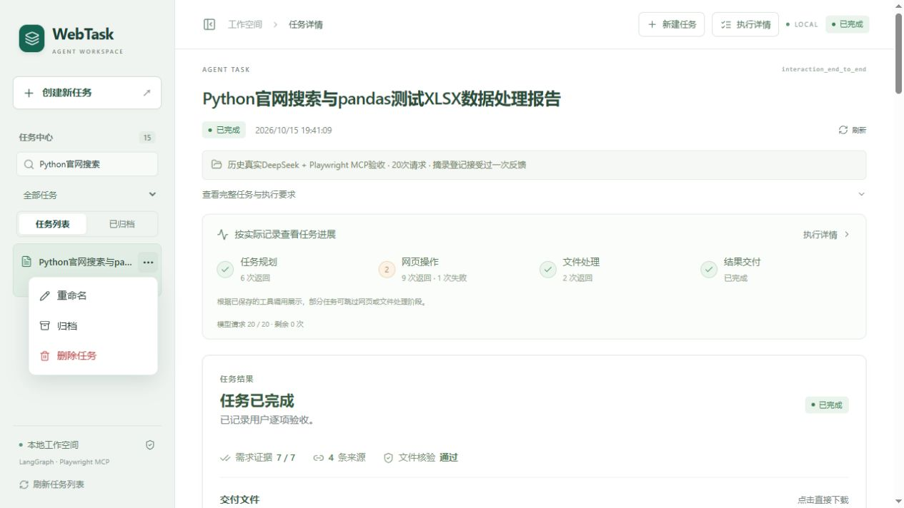
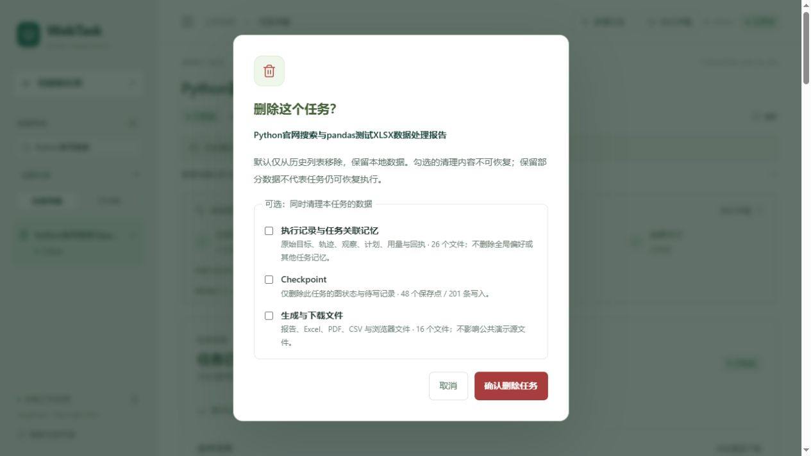

# 历史任务管理收尾

2026-10-16。本轮只改历史管理和生命周期入口，不改变 Agent 图、MCP、Harness、Skills、Memory 算法、完成判定或预算策略，新增付费请求 **0 次**。

## 使用

- 每条任务悬停、键盘聚焦或选中时显示 `···`。触屏始终显示；支持 Escape、菜单方向键和完整名称提示。
- **重命名**：只保存显示名称，1–160 字符；不覆盖原始任务目标、报告、来源或 Checkpoint。搜索仍可匹配名称与原始目标。
- **归档**：从默认列表隐藏。切换“已归档”，用 `··· → 恢复到任务列表` 恢复；状态和 Checkpoint 保留。归档视图保存在 URL，刷新仍能打开。
- **删除**：先展示二次确认与真实清理数量。默认三项均不勾选，只移出历史列表。可以分别清理执行记录及任务关联记忆、Checkpoint、生成/下载文件。
- **运行中删除**：先点击“先安全停止任务”，后端等待原任务取消和锁释放，再允许确认删除。其他进程占有的锁不强制移除。
- 删除当前任务后返回新建页；取消确认不改动数据。长名称在侧栏单行截断，悬停显示完整名称。

删除没有回收站。勾选的数据清理不可恢复；默认保留的文件/状态是本地备份，普通入口不能恢复已删除的任务。如果想以后继续执行，请用归档。删除后保留最小删除标记，旧请求、CLI 或演示导入不能用相同 ID 重建任务并重置计费预算。

## 持久化与安全边界

沿用原任务目录与 SQLite，在输出根目录 `.task_meta/{task_id}.json` 原子保存显示名称、归档和删除标记。它独立于任务文件，避免清理记录后任务重新出现。API 正常查询、执行、恢复及 Gradio 历史列表都过滤删除标记；归档只影响列表，仍可通过原任务 ID 读取。

清理前校验整个任务目录，拒绝越界、符号链接和 Windows 重解析点。清理使用与 Runner 相同的排他 `.running` 锁，显式逐个删除本任务文件，不递归操作公共目录。Checkpoint 通过已安装 SDK 的 `adelete_thread(task_id)` 删除该线程全部命名空间的图状态与 writes，不删除共享数据库或 WAL。Memory 只作废该任务的已验收摘要，其他摘要和全局偏好保留。

若文件占用导致部分清理失败，先保留删除标记并隐藏任务，弹窗说明原因；保持原选项重试，禁止扩大范围或重建执行。清理过程中不要退出页面。服务中断后可按原 ID 和原选项重试 DELETE API。公共 `demo_bundle`、其他任务与共享资源不在清理范围。

## 接口与关键文件

| 接口 | 用途 |
| --- | --- |
| `GET /tasks?archived=false` | 默认任务列表，排除归档/删除任务 |
| `GET /tasks?archived=true` | 已归档任务 |
| `POST /tasks/{id}/rename` | `{ "title": "任务名称" }` |
| `POST /tasks/{id}/archive` | `{ "archived": true/false }` |
| `GET /tasks/{id}/deletion` | 当前清理数量、Checkpoint 数量、运行锁及是否能停止/删除 |
| `DELETE /tasks/{id}` | `confirmation` 必须等于任务ID；`delete_records`、`delete_checkpoint`、`delete_files` 默认 false |

前端：`components/TaskHistoryItem.tsx`、`components/TaskHistoryDialog.tsx`、`App.tsx`、`api.ts`、`types.ts` 和局部 CSS。
后端：`web_agent/task_history.py`、`api.py`、`web_views.py`，`runner.py` 增加已删除 ID 入口拒绝；`dashboard.py` 同步列表过滤，`scripts/restore_demo_tasks.py` 避免重建已删除演示。

## 真实验证

- 全量 Python **201 项通过**（含本轮16项历史管理测试），前端 **25 项通过**（新增4项），TypeScript 检查和生产构建通过。
- 使用一次性隔离测试任务在浏览器完成重命名、刷新、归档、归档视图刷新、恢复、取消删除、默认保留数据删除、当前任务删除后回首页、运行中禁止删除及安全停止后删除。后端是真实 API/Runner/SQLite，模型为明确标注的脚本模型，未访问付费模型。
- 离线测试覆盖3类清理选项的全部8种组合，真实写入 Checkpoint/writes 后删除单个线程；验证其他任务、公共演示、全局偏好不变，防重复创建、锁、路径和部分清理失败。
- 在实际8000服务只读检查真实历史任务菜单与删除预览并取消；原历史验收仍是20次请求、35次工具调用，没有重复执行。
- 390px 窄屏菜单和弹窗均在视口内，无新增横向溢出；生产页面没有控制台错误。保留现有主布局和 Gradio 备用入口。

测试细节见 [本轮验证摘要](history_validation_summary.json)。XML与前端原始测试报告保存在私人开发目录 evidence，不进入公开包。本轮未重装操作系统/所有依赖，未新增外站模型任务；本地单用户单进程边界保持。

