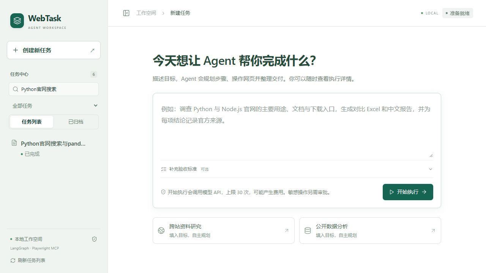
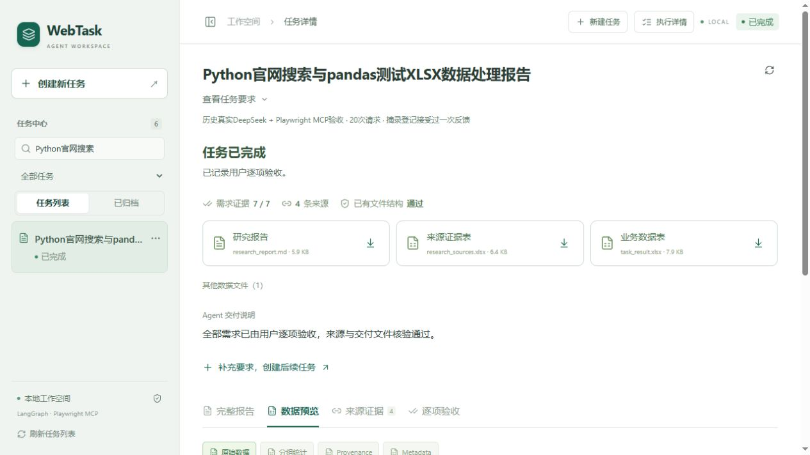
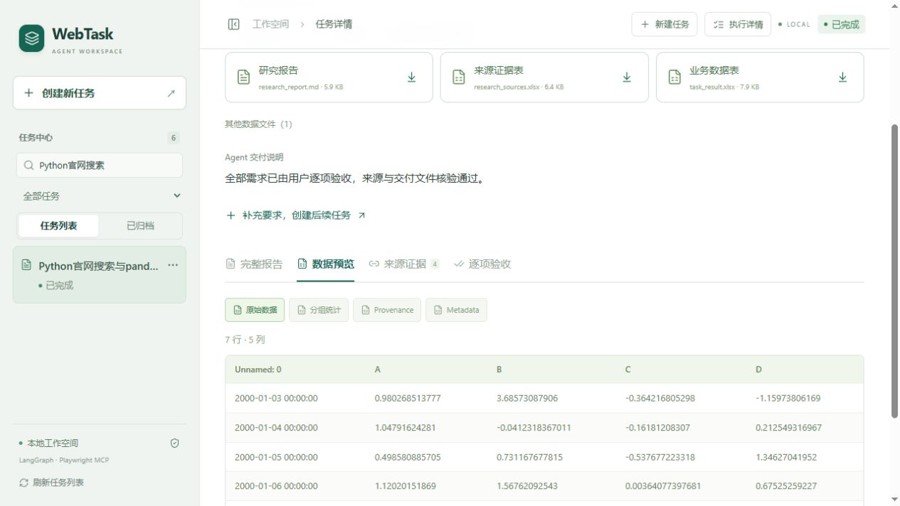
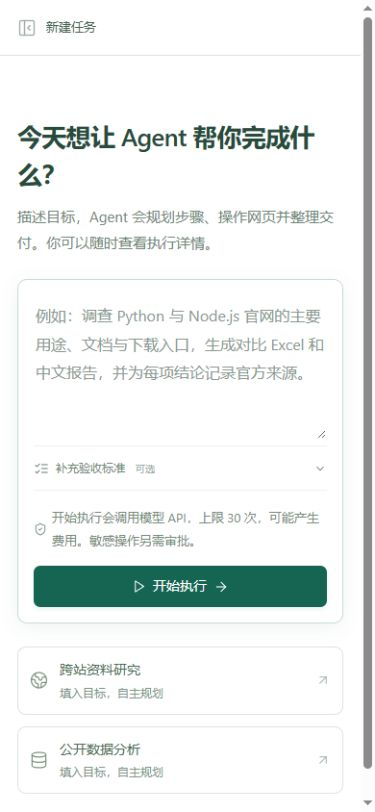

# 日常任务工作区：信息架构收尾

2026-10-16。本轮修改React组件、交互及样式，生产Python的25个模块哈希与修改前一致。228项Python回归、33项前端测试、TypeScript检查和生产构建通过，新增付费模型请求0次。

## 新旧流程

| 环节 | 原页面 | 当前工作区 |
| --- | --- | --- |
| 新建 | 已支持首页输入，保留此能力 | 输入目标、可选验收标准，点击开始后自动进入任务 |
| 执行 | 四章节导航、阶段大卡片、主区计划等同时出现 | 当前动作与最近4条真实操作；完整计划/参数/预算进抽屉 |
| 审批 | 与进度和占位结果混排 | 以需要确认的操作为焦点，后端审批绑定与计费确认保留 |
| 结果 | 结果摘要、报告摘录、大卡片和完整报告叠加 | 完成情况与未满足项、文件卡片优先；仅一个Tab预览区 |
| 文件 | 下载入口与独立预览位置 | 点击文件名称预览，旁边图标下载；来源Excel打开来源证据，业务Excel读取真实工作簿 |
| 后续 | 没有明确的关联后续任务入口 | 当前工作区补充要求，确认后创建独立任务，刷新后可返回关联原任务 |

去掉01/02/03/04章节导航、主区大阶段卡片、重复计划、报告摘录和技术栈宣传条。保留白灰背景与墨绿色，正文14–16px，报告正文限制约820px阅读宽度。中间只有一个主阅读区；详情抽屉默认关闭，覆盖展开并锁定背景滚动，不压缩报告区域。长报告本身仍需滚动。

## 连续交互的真实边界

本轮不把独立任务包装成“连续对话”。补充要求会创建新任务，在实际POST /tasks原始目标中保存关联原ID、有界原目标和交付说明，并明确这些是需重新核实的上下文。不会继续原Checkpoint，也不会自动读取原文件。创建前确认新预算与可能费用，原任务和原预算不变。

原任务中断后，只有后端can_resume允许时才显示“继续未完成的任务”；它继续使用已有Checkpoint与累计预算，与创建后续任务是不同入口。没有Checkpoint的启动失败给出具体原因与新建提示；只读演示不显示不可用的验收或恢复操作。结果待确认必须逐项核对，不能误当已完成。

关联是任务目标中的持久化标记，不增加数据库表或重复接口。它没有外键/级联删除能力；原任务删除后关联文字仍保留。当前Tab和抽屉展开状态是临时界面状态，刷新默认回到完整报告，真实状态及结果从后端重新读取。

## 代码

- App.tsx：复用原创建、SSE、恢复、审批、验收、历史管理流程；按实际状态组织主区。
- TaskProgress.tsx：从真实事件取最近4条操作，不合成计划完成率或内部推理。
- TaskOverview.tsx：唯一结果与文件入口；显示后端保存的交付说明，不生成新的结论。
- DeliveryPanel.tsx：一个完整报告/数据/来源/验收预览，保留安全Markdown和实际需求核验。
- TaskContinuation.tsx、related.ts：显式独立后续任务与有界上下文，关联由后端原任务文本持久保存。
- ExecutionPanel.tsx：原完整工具轨迹、计划、统计、预算和错误；按需抽屉，支持Escape、焦点返回与键盘边界。
- styles.css：移除上一轮四章节样式，增加工作区布局和抽屉样式；历史菜单等能力保留。

原生产FastAPI接口、Agent、MCP、Harness、Memory、Skills、Checkpoint、审批和Gradio均未修改。测试专用tests/web_ui_fixture.py仅补充权限拒绝与启动错误注入，不由生产入口导入。

## 实际验证

1. 在8002隔离服务，通过浏览器创建任务，自动进入原ID视图，收到真实LangGraph interrupt，拒绝后恢复并读取最终报告，刷新仍显示同一任务。
2. 运行中检查默认没有详情抽屉和占位结果；安全中断后从原ID恢复。脚本调用账本累计3次，实际外部API请求0次，不能把脚本次数当付费请求。
3. 在当前任务创建独立后续任务，确认新ID、刷新关联保留、点击返回原任务；原任务未重跑。
4. 通过真实宿主防护拒绝本机地址，显示明确权限原因和有效恢复入口；注入启动失败后显示错误及没有Checkpoint的提示，不提供虚假恢复。
5. 核对结果待确认的逐项勾选门槛；在正式服务查看既有只读演示，不能验收或恢复。没有自动批准或确认用户真实任务。
6. 正式服务读取既有公开历史任务，文件卡片直达真实Excel预览，负数与日期正常；下载接口200，工作簿字节匹配实际文件，Markdown匹配脱敏预览及attachment响应头。没有自动操作系统保存对话框。
7. 检查1280px桌面、390px窄屏、侧栏折叠、抽屉展开关闭、报告/数据切换，未见外层横向溢出或控制台错误。

完整记录见[验证摘要](product_validation_summary.json)。原始隔离运行轨迹、Checkpoint、XML报告和下载核对记录保留在私人evidence/work目录，不进入公开包。本轮没有新增付费DeepSeek或外站模型任务，不把UI测试称作新的Agent成功率。

启动方式不变：run_web_windows.bat；已有服务直接Ctrl+F5刷新。

