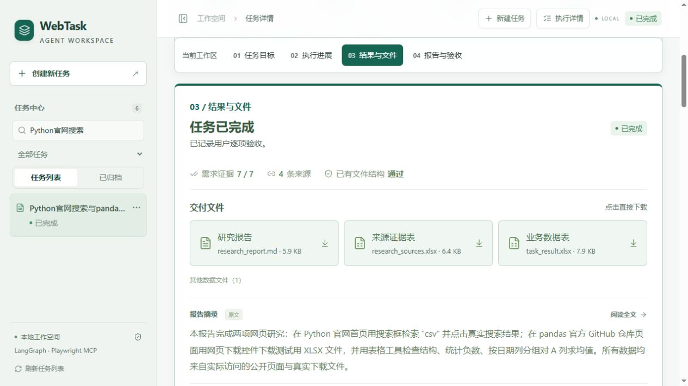
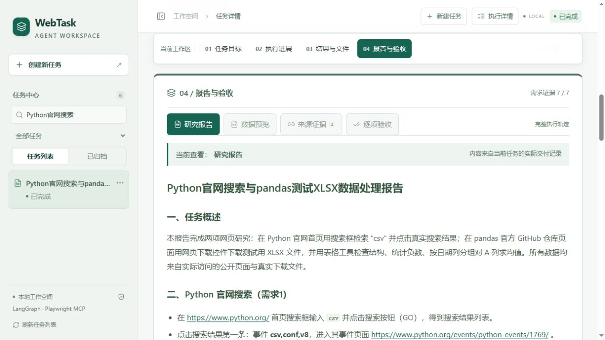
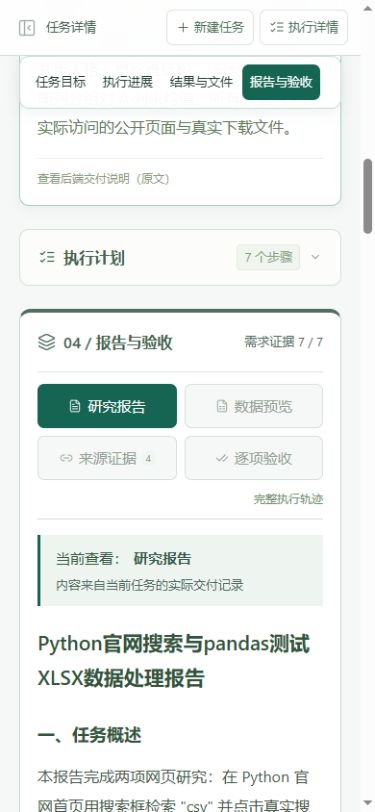

# 可读性与任务纠错收尾

2026-10-16。保留现有React工作台、FastAPI和单Agent架构。本轮228项Python、27项前端测试通过，TypeScript检查和生产构建通过；新增付费模型请求0次。

## 页面改动

- 桌面左侧历史栏从248px加宽到292px；较窄桌面272px，手机保留抽屉。历史名称15px，支持原有搜索、状态、菜单和折叠。
- 主要正文、报告与表格16px，按钮/标签主要14–15px，辅助信息提升至13px并加深对比度。保留墨绿品牌色。
- 中间分为01任务目标、02执行进展、03结果与文件、04报告与验收。不同顶边与浅底色区分：目标白底、进展浅蓝、交付墨绿强调、报告独立边框。
- 顶部固定内容导航，点击直接跳转，滚动自动标记阅读位置。它只表示当前阅读区域，绝不伪造执行进度。
- 报告/数据/来源/验收切换后显示“当前查看”，选中标签实色突出；文件卡片增加边界与字号。技术轨迹保持按需展开。
- “文件核验”改为“已有文件结构”，避免误解为全部需求或语义事实均通过。needs_review仍是结果待确认，不能当completed。

## 稳定性改动

研究入口增加受约束的browser_search，使用原MCP会话和原公网出口限制；固定搜索提供方、编码查询、拒绝凭证、真实快照与链接。搜索摘要仅用于发现来源；要打开原文再引用。搜索页加载后有限再次观察，没有结果项就返回search_empty；中文验证页归为site_challenge，不绕过登录/验证码。页面main为空时读body渲染文本，避免错误地读到空内容。

业务表导出失败会原子保存本任务的business_draft.json，错误提供draft_id。Agent可通过repair_business_excel仅修正表名/Excel行号/列名对应的entry，避免反复重写大表。随后仍校验整表来源；不会替模型补值或接受概括。草稿版本不匹配、越界、重复格和错误入参均拒绝，成功后删除草稿。同类导出和单元格修正累计三次连续校验失败就停止；工具尝试、模型请求和原Checkpoint预算不重置。

关键文件：frontend/src/components/TaskSections.tsx、TaskProgress.tsx、TaskOverview.tsx、DeliveryPanel.tsx、App.tsx、styles.css、model.ts、ux.ts；web_agent/browser.py、business_excel.py、tools.py、harness.py、graph.py、web_views.py；对应研究Skill及tests/test_browser_search.py、tests/test_export_correction.py、frontend/src/sections.test.tsx。

## 验证与诚实边界

- 全量228项Python回归覆盖旧Agent、审批、Checkpoint、预算与文件校验。本轮单元格修正额外6个用例，包含真实LangGraph脚本模型读取失败draft_id并仅修正一格后完成导出；这是离线模型决策测试，不是DeepSeek效果验收。
- 27项前端测试、TypeScript和生产构建通过。实际页面验证了分区跳转、选中位置、数据预览、历史栏折叠、执行轨迹展开、1280px桌面和390px窄屏；没有外层横向溢出。截图来自既有公开历史案例，没有伪造任务。
- 免费真实MCP验证：访问Python官网，输入csv、点击GO、观察搜索结果，再跟随真实ref打开结果，成功返回原文。使用同一个MCP会话，未构建模型或使用DeepSeek API。此前受限环境尝试遇到ERR_CONNECTION_CLOSED，已如实记录；这次在正常宿主权限下完成。
- browser_search搜索引擎封装本轮通过离线协议测试；上述真实MCP验证针对官网站内搜索，不冒充所有公网搜索提供方均已通过实测。网络、验证码和网站变化仍可能导致失败。
- 本轮没有新增付费模型端到端评测，没有自动执行、审批或确认用户任务，不承诺复杂跨站研究成功率。比较表抽取校验不代表招聘资格、政策适用和时效判断自动正确，结果待确认仍须核对。

完整免费验证摘要：[usability_validation_summary.json](usability_validation_summary.json)。私人原始日志和Checkpoint不进入公开包。启动方式不变，运行run_web_windows.bat，刷新浏览器即可加载新界面。

