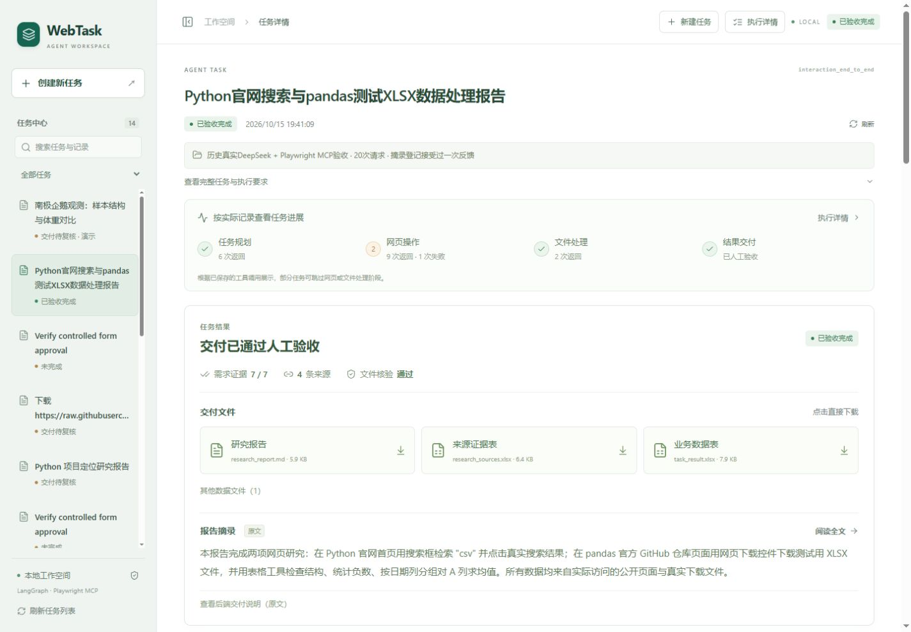
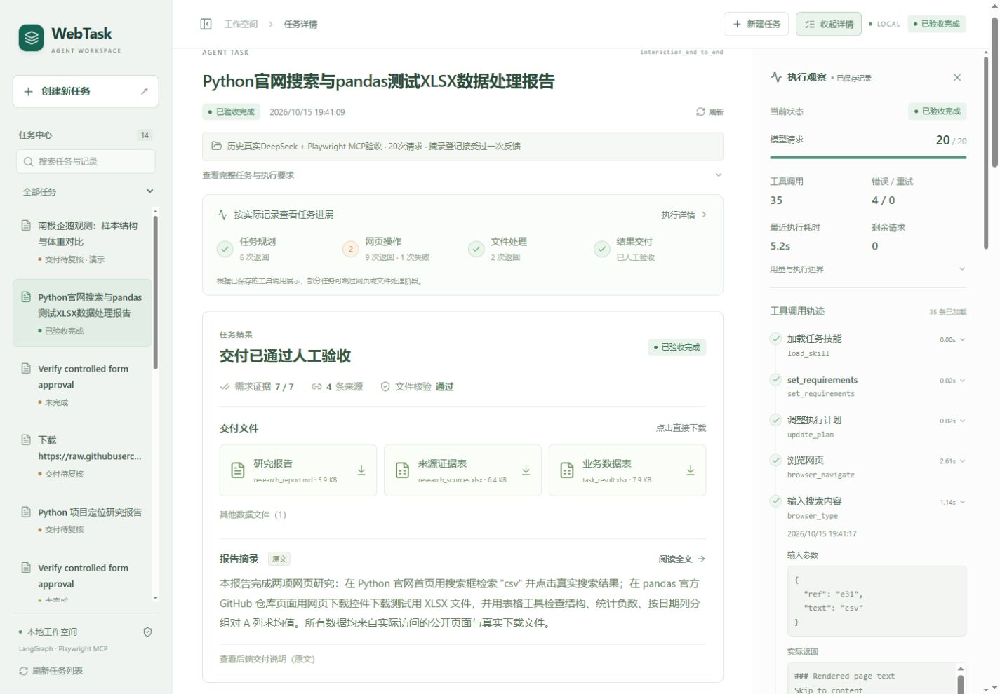
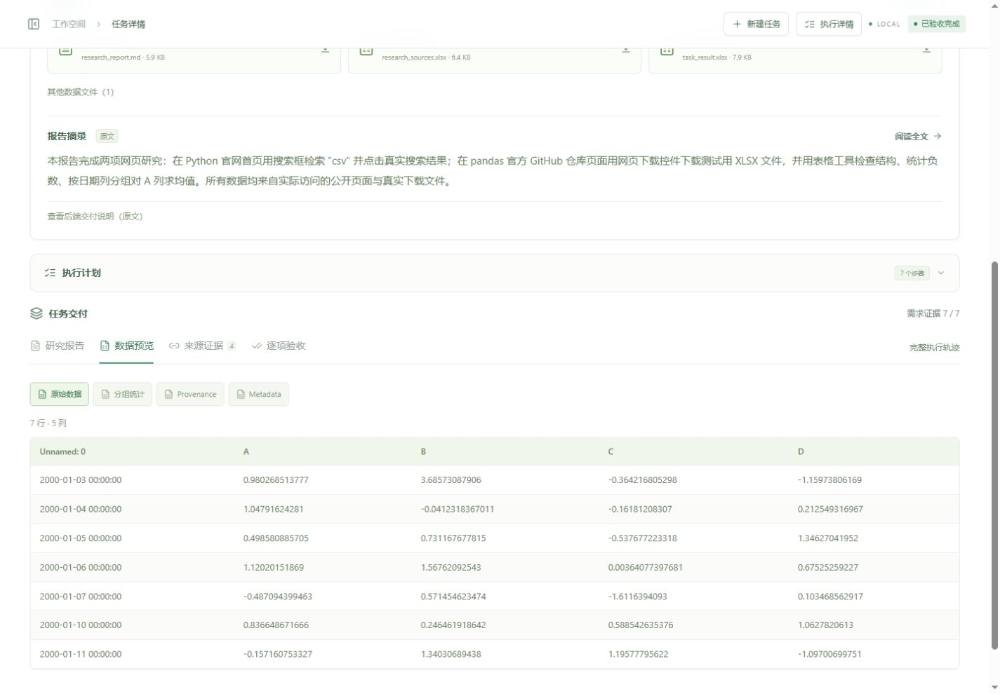

# 任务优先 UX 收尾验收（2026-10-16）

本轮只修改现有 React 界面的信息布局和交互，保留白灰色与墨绿色风格。未新增依赖，未调用付费模型。项目仍在 本地项目目录，直接使用 `run_web_windows.bat` 启动，访问 http://127.0.0.1:8000/ 。已有页面需刷新以加载最新构建。

## 操作变化

| 使用环节 | 之前 | 现在 |
| --- | --- | --- |
| 打开首页 | 自动选中历史演示，再点击新建 | 直接显示“今天想让 Agent 帮你完成什么？” |
| 提交目标 | 新建入口、开始、二次创建确认 | 填好目标后一次“开始执行”；按钮附近明确展示预算与费用提示 |
| 查看进展 | 右侧轨迹常驻 | 默认紧凑阶段条；按需展开完整执行详情 |
| 阅读报告 | 中间区域始终受两侧挤压 | 右侧默认收起，左侧也可收起，正文自动扩展 |
| 查看交付 | 长报告之后找文件 | 先显示真实完成状态、需求检查、交付文件和标注原文的报告摘录 |
| 需求验收 | 需要找到报告下方的验收标签 | 结果摘要直接“逐项核对”，保留全部后端验收门槛 |
| 人工审批 | 技术 JSON 阅读成本高 | 操作、目标、原因和提交字段直接可读；完整 JSON 折叠保留 |
| 恢复任务 | 短暂跳回首页后重新进入 | 同一任务重连并更新，累积请求预算不重置 |

开始按钮仍会创建真实任务并可能计费；本轮浏览器创建测试仅连接独立离线测试服务。敏感操作审批、恢复和最终验收的确认保留。创建后的任务 ID 写入 URL，刷新从后端恢复原任务。未发送草稿可在当前页面切换历史时保留，但刷新不保留草稿及面板偏好。

## 实际修改位置

- `frontend/src/App.tsx`：首页、单次提交、防重复操作、历史/详情折叠、同任务重连、审批与恢复位置。
- `frontend/src/ux.ts`：从真实事件提取阶段，从报告提取原文段落，不生成新的业务结论。
- `components/TaskProgress.tsx`：真实调用阶段、当前活动、中断入口和详情快捷入口。
- `components/TaskOverview.tsx`：真实需求/文件核验、优先下载、原文摘录。
- `components/ApprovalDetails.tsx`：可读审批信息与完整字段，原始 JSON 按需展开。
- `components/ReportMarkdown.tsx`：复用安全 Markdown 渲染，忽略 HTML、限制链接且不自动加载外部图片。
- `components/DeliveryPanel.tsx`、`ExecutionPanel.tsx`：原有报告/数据/来源/验收及完整轨迹，接入快捷跳转和收起操作。
- `styles.css`：自动扩展、窄屏抽屉、局部表格滚动与更清晰的字号层级。
- `ux.test.tsx`：新增 12 项 UX 回归，原 6 项前端测试保留。

阶段条只归纳已有工具事件；没有事件的阶段显示“未记录调用”。历史错误仍保留；`needs_review` 是“交付待复核”，不会显示为“已人工验收”。报告摘录是原文，完整结论以报告和来源为准。

## 已完成的免费验证

- **136 项 Python 回归通过，18 项前端测试通过**；TypeScript 类型检查、生产构建通过。
- 与本轮开始前基线比较，**23 个 Python 核心/API/Gradio 文件 SHA256 全部一致**。本轮没有修改 Agent、权限、预算、Memory、Skills 或 Checkpoint 的实现。
- 当前生产前端源文件与构建产物共 20 个文本文件扫描，未发现本机 `.env` 中实际密钥值；不会将密钥写入证据。
- 生产服务读取原有 `interaction_end_to_end` 和 `penguins_public_demo`；报告、来源、验收状态、实际 XLSX 预览可用。两个案例的四次 XLSX HTTP 下载均为 200，下载字节 SHA256 与本地实际文件一致。
- 1440 桌面中间区域宽度：右侧关闭 1177px、打开 837px、两侧都关闭 1425px。390、1280、1024 有效视口宽度均无页面整体横向溢出；宽表仅在自身容器内滚动。390x844 首页无需先点新建即可看到输入和开始按钮。
- 隔离测试服务使用真实 FastAPI、runner、LangGraph interrupt、SQLite 和审批接口，模型为明确的免费脚本替身。验证一次点击创建、自动进入任务、拒绝审批、同任务恢复、中断，以及复制公开交付物后的逐项人工验收。原始生产案例未被测试覆盖。
- 历史真实任务仍是 **20 次模型请求、35 次工具调用**，没有重跑或重置。离线脚本决策次数不计作 DeepSeek 请求。

详细本机证据：`evidence/ux_validation.json`、`ux_browser_checks.json`、`ux_pytest.xml`、`ux_frontend_tests.json`。这些原始记录不自动进入公开包。

## 边界与仍未验证的事项

本轮新增付费请求为 **0**；没有新跑 DeepSeek + 外部网页端到端任务，也没有新批准真实外站表单。审批与恢复的 UI 验证属于隔离离线测试，真实浏览器/进程恢复能力引用之前的历史证据，不能包装成本轮新增在线验收。1024px 测试验证有效宽度下的重排，没有实际改变浏览器全局缩放百分比。本地单用户、原有预览行列上限和权限范围保持原有限制。

当前可以作为求职演示版使用，既能直接创建任务，也能按需展示工程轨迹。现场演示优先读取历史任务；若要现场提交或恢复真实任务，需另行确认费用预算。无需继续追加框架或新业务功能。

## 真实运行截图

首页直接输入：

真实历史交付优先：

按需展开执行记录：

扩大真实 Excel 预览：

窄屏首页：

