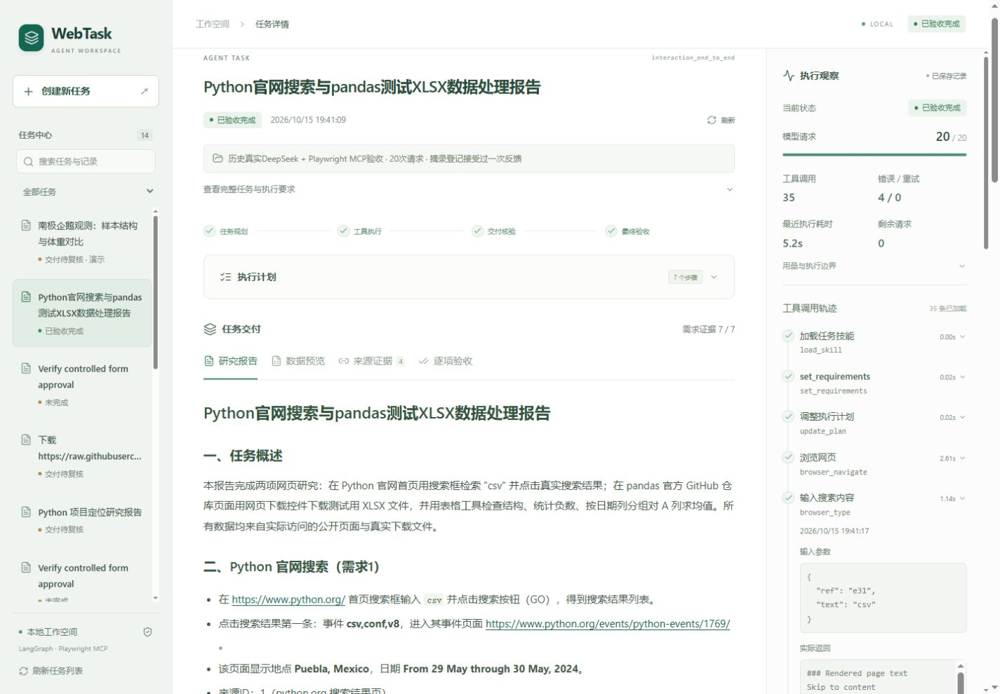
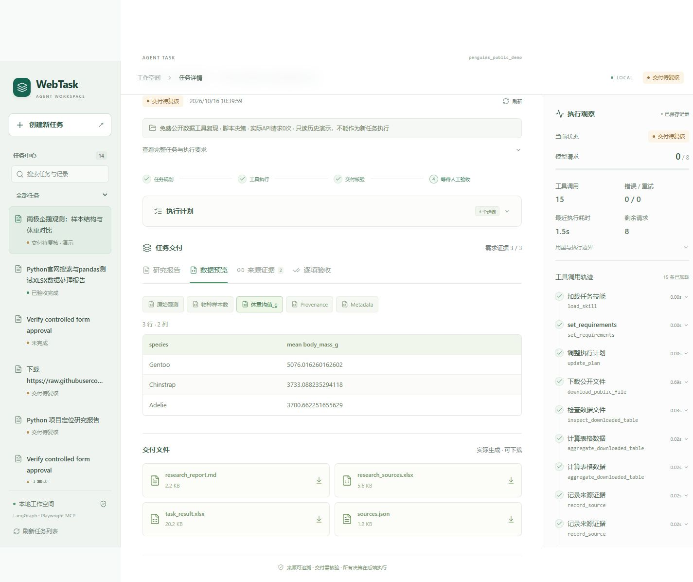
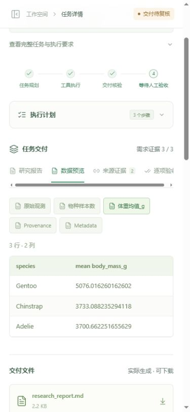

# 独立 Web 工作台交付说明

最新任务工作区以 [PRODUCT_WORKSPACE.md](PRODUCT_WORKSPACE.md) 为准；四章节布局已经移除，下文旧UI说明作为历史阶段记录。

最新可读性、逐格纠错及228项Python/27项前端回归见 [USABILITY_RELIABILITY.md](USABILITY_RELIABILITY.md)。

最新历史任务管理及201项Python/25项前端回归见 [HISTORY_MANAGEMENT.md](HISTORY_MANAGEMENT.md)。最新网络、安全预算与完成策略以 [FINAL_STABILITY.md](FINAL_STABILITY.md) 为准；前轮185项Python、21项前端测试通过。下文保留前端升级阶段的接口与历史验收说明。

本轮在原 Python Agent 上增加 React + TypeScript + Vite 界面，未更换 LangGraph 图、MCP 浏览器、Harness、Skills、Memory 或 Checkpoint。Gradio 继续作为备用入口。

最新界面为任务优先布局：首页直接输入，历史与执行详情可收起，先看交付再读报告。本轮 UX 验收及截图见 [UX_OPTIMIZATION.md](UX_OPTIMIZATION.md)。

## 启动

Windows 推荐 Python 3.12，Node.js 22.12+ 或 24 LTS，所有文件可安装在 D 盘。

1. 首次安装：双击根目录 `setup_web_windows.bat`。它复用 `.venv`，用 `npm ci --ignore-scripts` 安装锁定依赖，进行 TypeScript 构建、前端测试和 `pip check`。没有 Python 环境时才调用已有 `setup_windows.bat`。
2. 启动主界面：双击 `run_web_windows.bat`，打开 http://127.0.0.1:8000/ 。构建后的 React 由 FastAPI 同源托管，日常展示只需一个 Python 服务。打开页面不会执行任务。
3. Gradio 备用入口：原 `run_windows.bat`，http://127.0.0.1:7860/ 。不要用两种入口同时执行同一任务。
4. 修改前端后重新运行 `setup_web_windows.bat` 以更新构建。已有 ResearchFlow 服务时重复启动会打开现有页面；8000 被其他服务占用时明确退出，不会终止未知进程或占用其他端口。

开发模式使用两个终端：

```powershell
# 项目根目录，终端一
.\.venv\Scripts\python.exe -m uvicorn web_agent.api:app --host 127.0.0.1 --port 8000

# 项目根目录，终端二（已安装 Node）
$env:npm_config_cache = "$PWD\work\npm-cache"
cd frontend
npm ci --ignore-scripts
npm run dev
```

开发前端为 http://127.0.0.1:5173/ ，Vite 将 `/tasks`、`/settings` 和 `/health` 代理到本地 8000。生产构建通过 `npm run build`；所有 npm 缓存和临时文件由 Windows 脚本设置在项目 `work` 下。若自定义终端安装依赖，也应自行设置缓存目录。

密钥只放根目录 `.env`；不要创建包含密钥的 `VITE_*` 变量。前端只得到“密钥是否已配置”的布尔值。创建任务、恢复和审批后的继续可能产生 API 费用：创建前在按钮附近明确展示预算与计费提示，点击“开始执行”即提交；恢复和审批继续需弹窗确认；启动、预览、下载、中断及最终验收不调用模型。

## 实际复用和补充

| 能力 | 实现 |
| --- | --- |
| 创建任务 | 复用 `POST /tasks`，新增持久化幂等键及排队记录，防止重复点击或响应丢失后重复执行 |
| 查询任务 | 复用 `GET /tasks/{id}`；补充 `GET /tasks` 历史列表和 `GET /tasks/{id}/workspace` 完整界面数据 |
| 执行事件 | 新增 `GET /tasks/{id}/events` SSE，从原有真实 JSONL/公开摘录读取，不生成虚构事件 |
| 中断、恢复 | 复用 `/cancel`、`/resume`，继续原 `run_task()` 和 SQLite Checkpoint；不重置请求计数 |
| 操作审批 | 复用 `/review`；approve 仍要求当前 `approval_id` 与 `submit_public_form` 绑定 |
| 最终验收 | 复用 `/acceptance`、`/accept`，全部有效需求、文件与当前 binding 通过后才可 completed |
| 文件交付 | 复用 `/files/{filename}`，加强路径检查与 JSON/轨迹脱敏；新增 `/workbook` 返回有限真实单元格 |
| 公共配置 | 新增 `/settings`，仅模型名、预算、域名及配置布尔值；无密钥、Cookie 或 MCP 凭证 |

## 前端模块

- `frontend/src/App.tsx`：任务选择、创建、恢复、审批、中断、连接与页面状态。
- `frontend/src/api.ts`：请求封装、错误处理和幂等请求头。
- `frontend/src/model.ts`：状态文案、阶段、事件去重、工具调用分组和链接检查。
- `frontend/src/components/DeliveryPanel.tsx`：Markdown、Excel、来源与逐项验收。
- `frontend/src/components/ExecutionPanel.tsx`：真实工具轨迹、参数/返回/错误、预算和恢复事件。
- `frontend/src/types.ts`：API 数据类型；`styles.css`：统一绿白灰布局与响应式样式。
- `web_agent/web_views.py`：有界预览、凭证脱敏、持久化状态及操作能力判断。
- `web_agent/api.py`：原 API 与新增读接口、SSE、同源静态文件、安全来源边界。

未增加前端业务决策引擎、前端工作流编排、向量数据库或多 Agent。

## 事件、状态与安全

初次打开读取完整持久化工作区；URL 保存任务 ID，刷新按 ID 恢复。SSE 使用真实记录序号作为事件 ID，支持 `after`/`Last-Event-ID`；前端按 ID 去重、排序，浏览器断线自动重连。每 5 秒额外拉取工作区以同步计划、审批、文件和最终状态，网络错误不会被当成完成。终态关闭 SSE，显式恢复后重新连接。服务重启不自动执行旧任务；遗留进程锁需按原恢复说明确认处理。

`needs_review` 显示交付待复核；`completed` 才完成最终验收。阶段条归纳真实工具记录，不强制将每个任务的所有阶段标为完成；没有对应调用时显示“未记录调用”。权限拒绝、预算耗尽、重复失败、超时、部分完成、中断、等待操作审批分别显示。计划是原文步骤，没有根据时间伪造百分比或逐项完成进度。Token 数量缺失时显示“—”；耗时显示最近一次运行记录，运行中根据持久化开始时间计时，不冒称跨进程累计耗时。真实历史任务与免费脚本案例保留执行方式说明。

- API 仅绑定 127.0.0.1，单进程单用户；CORS 只允许 localhost/127.0.0.1 的 5173/8000。非本地 Origin 的写请求拒绝，不提供公网身份系统。
- 下载文件名使用固定白名单，校验任务目录及文件真实路径，拒绝越界、符号链接与重解析到目录外的路径。
- 工作簿限制压缩文件大小、解压总量、工作表数量和最多 50 行/30 列，超限明确提示。
- Markdown 使用 react-markdown + GFM，忽略原始 HTML，限制链接为 HTTP(S)，不自动加载外部图片；不使用 dangerouslySetInnerHTML。
- 工具参数、返回、URL、JSON 和报告经服务端凭证与本地路径脱敏；下载的轨迹也是脱敏版本，不提供原始消息或内部思考。
- 只读演示在后端拒绝恢复，不能通过绕过禁用按钮调用模型。

## 测试与真实验证边界

本轮新增 API 集成测试位于 `tests/test_web_workbench.py`。测试使用实际 runner、工具、文件、SQLite、interrupt 和 API，模型为脚本替身，**不属于新增在线模型验收**。原有模型验收证据继续保留，预算没有重置。本轮实际付费请求为 0。

初版 Web 升级结果（历史记录）：136 项 Python 测试、6 项前端测试通过；TypeScript 类型检查、生产构建、Windows 前端安装脚本和 npm 审计通过（0 个已知漏洞）。新增免费接口测试 10 项，历史 126 项仍通过。完整结果见 `evidence/web_validation.json`、`evidence/web_pytest.xml`、`evidence/web_frontend_tests.json` 与 `evidence/web_browser_checks.json`。

Windows 前端安装脚本已在当前 D 盘项目中实跑 `npm ci`、构建、前端测试、pip check；Python 使用原有已验证环境，不能据此宣称在另一台全新 Windows 完成了无缓存 Python 安装。

浏览器免费验收使用独立的 `work/web-ui-smoke` 目录和 `tests/web_ui_fixture.py` 服务：测试创建、interrupt、拒绝后恢复、中断、最终验收以及页面刷新。此服务器不被生产入口导入，模型被固定为脚本模型，无外部 API。生产工作台只读取原有真实案例，未用测试状态替换案例。

## 已知限制

- 本轮未获新的付费调用授权，未从 React 发起新的 DeepSeek + 外部网页完整在线验收；可展示已有真实记录和经过免费验证的前后端执行链路，不能宣称新增在线成功率。
- 网页外部写入仍限原后端支持的受约束表单，登录、支付、验证码等不开放。浏览器界面本轮验证了实际 interrupt 的拒绝与恢复；任意真实站点的批准提交未新测。
- 页面不是多用户服务，排队不属于独立持久化调度器；进程重启后不会自动重放未启动的任务。已有 Checkpoint 需显式恢复。
- SSE 读取持久化轨迹，不转发模型思维链；展示有界结果摘录，不保证包含网页全部内容。重连游标与去重有自动化测试，已实际停止并重启 API，终态任务自动恢复读取、清除临时网络提示，原20次请求/35次工具计数不变；运行中SSE的断线场景只做了游标协议与客户端去重测试，未在浏览器另行诱发。
- XLSX 预览最多前 8 个工作表、每表 50 行/30 列；完整文件可以下载。原有表格处理范围及执行预算仍受后端限制。
- 公网部署、身份认证、任务隔离和多进程队列不在本轮范围。

## 最新 UX 验收

136 项 Python、18 项前端测试、类型检查及构建通过，0 新增付费请求。Agent/API/Gradio 的 23 个核心文件 SHA256 与 UX 修改前一致。详见 [UX 收尾记录](UX_OPTIMIZATION.md) 和 `docs/ux_validation_summary.json`。

## 初版截图（历史）





技术文档参考：[Vite 官方指南](https://vite.dev/guide/)、[FastAPI 流式响应](https://fastapi.tiangolo.com/advanced/custom-response/)。
